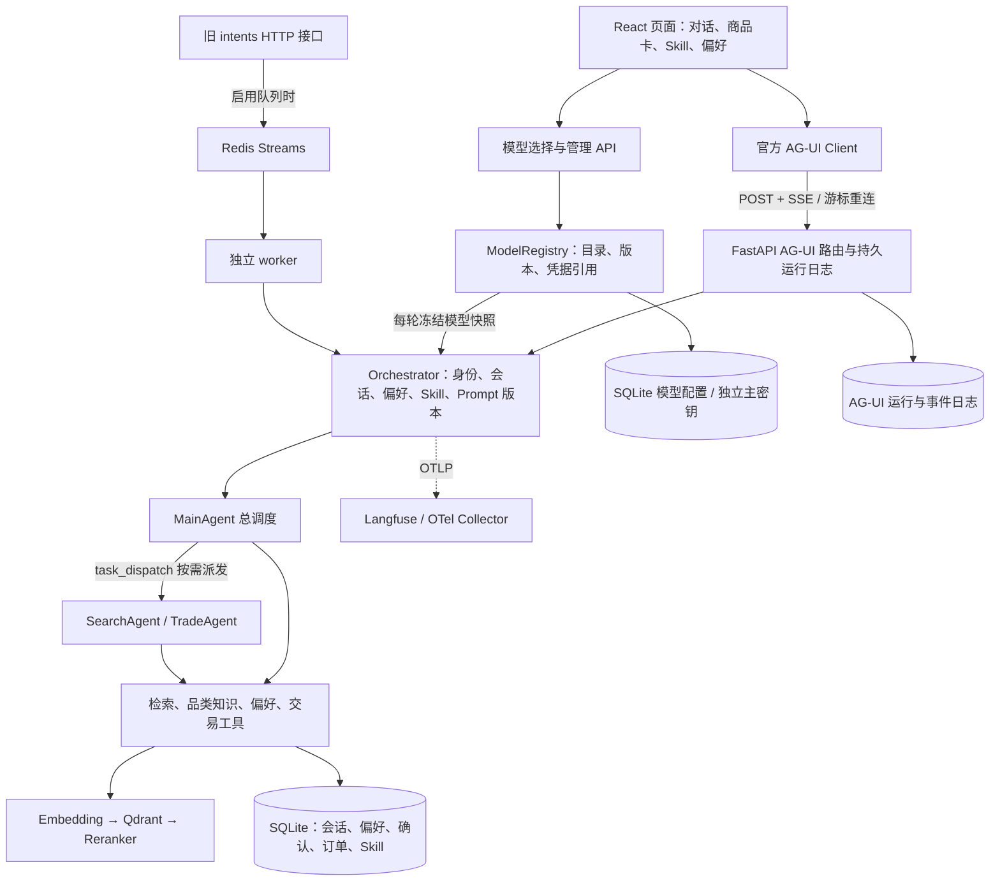

# ShopPilot · 跨境电商选购 Agent

基于 **AgentScope 2.x + FastAPI + AG-UI + React** 的电商 Agent 工程。买家用自然语言描述需求，Agent 调用商品检索、品类知识和交易工具，页面实时渲染回答、商品卡和确认单；个人 Skill 与长期偏好可以直接在页面编写和保存。

这是带持久化、运行恢复、观测和评测机制的工程实战项目。商品来自版本化样例目录，订单是本地业务账本，尚未接入真实电商供给、支付或物流。正式质量与收益验收仍有未通过项；启动成功或单测通过不能替代效果验收。下文依次介绍启动、页面能力、技术架构、数据保存及验证方式。


## 先选一种启动方式

| 方式 | 适合谁 | 需要什么 |
| --- | --- | --- |
| 让 Codex 帮忙启动 | 第一次接触工程、环境不熟悉 | 在 Codex 中打开本工程，准备可用模型凭据 |
| 本机双终端 | 开发、调试、修改前端 | Python 3.11–3.13、uv、Node.js 22、npm、模型服务 |
| Docker Compose | 验证 API、worker、Redis、Qdrant 与静态前端组合 | Docker Engine/Desktop、Compose v2、模型服务 |

### 让 Codex 帮忙跑起来

在 Codex 中打开 **`shoppilot` 目录**（包含本 README、`pyproject.toml`、`frontend/`），可以直接说：

> 帮我把这个项目跑起来。先读 README 和现有配置，检查前置环境与端口；保留现有数据和 .env，不要覆盖。安装缺失依赖，启动前后端，验证健康检查和一次真实页面选购，最后告诉我访问地址。缺少模型凭据时告诉我需要配置哪些字段，不要打印密钥。

遇到问题可以继续追问，例如“页面一直转圈，请检查后端和模型日志”“刷新后看不到之前的记录，请核对买家身份和服务端数据”“解释这次请求经过了哪些 Agent 和工具”。提供错误信息即可；密钥填写在本机 `.env` 中，不需要贴到对话里。

### 本机启动：推荐开发路径

以下命令均从 `shoppilot` 根目录执行。Python 版本范围由 `pyproject.toml` 约束；Node.js 22 与前端 Docker 构建保持一致。模型服务须支持 OpenAI 兼容协议、工具调用和流式输出，且当前账户能访问所选模型。

**1. 检查环境、安装依赖。**

```bash
python3 --version
uv --version
node --version
npm --version
uv sync --frozen
npm --prefix frontend ci
```

机器缺少 uv、Python 或 Node.js 时，可让 Codex 按当前系统补齐。工程复制或移动后不要继续依赖旧虚拟环境的绝对路径；重新同步依赖，并优先使用下文的 `python -m` 入口。

**2. 配置模型。已有 `.env` 时直接编辑，不覆盖。**

```bash
# 仅首次创建；存在时保持原文件
if [ ! -f .env ]; then cp .env.example .env; fi
```

在 `.env` 中填写以下字段。示例模型名对应默认网关，换供应商时也要换成该账户实际可用的模型。

```dotenv
LLM_BASE_URL=https://dashscope.aliyuncs.com/compatible-mode/v1
LLM_API_KEY=填写你的真实密钥
LLM_MODEL=qwen3-max
LLM_FALLBACK_MODEL=qwen-plus
EMBEDDING_MODEL=text-embedding-v4
```

只有 `LLM_API_KEY` 非空才允许启动；占位字符串不能用于真实对话。Embedding 默认复用 LLM 的网关和密钥，网关不支持 embedding 时需单独配置 `EMBEDDING_BASE_URL`、`EMBEDDING_API_KEY`。环境变量优先于根目录 `.env`。首次启动会加载商品目录、初始化持久库，并尝试建立商品和知识向量索引，可能需要一段时间和 embedding 调用费用。

需要供应商公开的 Think 输出时，可设置 `LLM_ENABLE_THINKING=1`（或 `true`）并重启后端；`0`／`false` 明确关闭，未设置或留空则不发送参数，保持原行为。此配置导入“当前网关”模型档案；页面只展示档案已声明的思考选项。兼容迁移的主模型和回退模型都继承该声明，因此两者须支持 `enable_thinking`；不支持时应配置兼容模型或留空 `LLM_FALLBACK_MODEL`。自定义连接按自身声明与校验结果使用思考开关或强度，不能按模型名称猜测。Think 可能增加耗时和用量；未返回 `reasoning_content`／`reasoning` 时，页面不会生成思考内容。Compose 已向 `app`／`worker` 透传这些配置；环境改动后需重新创建相应容器，已有会话仍按冻结版本执行，可在模型列表重新选择新版本。

最小本机模式使用 SQLite 和本地 Qdrant，无需 MySQL、Redis、Docker 或 Langfuse。首次体验建议不配置 `REDIS_URL`、`QDRANT_URL`；已有配置不要为了启动随意清空，应先确认原有数据与依赖。

**3. 终端一启动后端。**

```bash
uv run python -m uvicorn app.presentation.server:app --host 127.0.0.1 --port 8000 --workers 1
```

本地 Qdrant 对数据目录持有进程锁，先保持单进程，不要同时启动第二个后端或 worker 共用该向量目录。修改后端代码后重启此进程；`Ctrl+C` 可停止。

自动化默认随这个后端启动（`AUTOMATION_WORKER_MODE=embedded`），不需要另开定时进程。关闭浏览器不影响调度；后端停机或电脑休眠会暂停执行。设置 `off` 可停用调度，已保存的任务和历史仍保留。

使用 Qdrant 服务端、需要分开部署时，将 Web 后端设为 `AUTOMATION_WORKER_MODE=external`，再用同一份配置和持久数据目录运行 `uv run python -m app.automation_worker`。独立 Worker 必须配置 `QDRANT_URL`，并共享会话、事件、模型及 Skill 数据。已有 Redis 队列 Worker 与自动化 Worker 是不同入口。

**4. 终端二启动前端。**

```bash
npm --prefix frontend run dev -- --host 127.0.0.1 --port 5173 --strictPort
```

打开 [http://127.0.0.1:5173](http://127.0.0.1:5173)。`--strictPort` 避免端口占用时自动换端口而不知情。前端同源代理 `/commerce` 和 `/health` 到 `http://127.0.0.1:8000`，通常不用配置 CORS 或 `VITE_API_BASE`。

已有本机页面若在 **5174**，继续使用原地址即可；5173 是项目默认端口。需要使用 5174 时，将命令中的端口改为 5174。默认用户固定为 **`pao-coder`**，不需要登录。只要前端连接同一后端数据库，刷新、换端口或没有浏览器缓存，都会按该用户查询历史和使用数据。

**5. 验证确实跑通。**

```bash
curl --fail http://127.0.0.1:8000/health
```

健康接口应返回 `status: ok`，数据库与启用的 Redis 不应报错；该检查不保证模型、精排服务可用，还要在页面发送一次“预算 300 元以内，找一个寄到中国的轻便背包”。检查流式回答、商品卡及运行记录。接口交互文档位于 [http://127.0.0.1:8000/docs](http://127.0.0.1:8000/docs)。

要检查生产构建而非开发热更新：

```bash
npm --prefix frontend run build
npm --prefix frontend run preview -- --host 127.0.0.1 --port 5174 --strictPort
```

先确认 5174 没有现有服务。Preview 使用 `dist/`，修改源码后需重新 build 并刷新页面。

## 页面能做什么

| 入口 | 使用方式与实际行为 |
| --- | --- |
| 我的选购 | 输入用途、预算、收货地；流式回答、商品卡、规格详情、2–3 件比较、心选收藏 |
| 思考与执行记录 | 对话中展示工具步骤，展开查看条件和结果摘要；“执行记录”集中查看各轮过程。Think 仅展示供应商公开返回的思考流，模型未返回时不补造 |
| 模型选择与管理 | 输入区选择模型、思考档位与上下文上限；管理列表显示和默认选项，校验后添加或编辑自定义连接；“设为新会话默认”是独立操作 |
| 上下文用量圆环 | 点击查看当前模型、窗口和计数口径，手动整理工作上下文；完整对话与商品卡保留 |
| `/` 选择 Skill | 输入 `/` 选择方案后发送；服务端核对版本与内容哈希、读取正文，再交给 Agent 执行 |
| 我的 Skill | 编写名称、使用场景和 Markdown 步骤；保存、修改、删除均走服务端；仅当前买家可用，不自动发布为公共方案 |
| 长期偏好 | 添加、编辑、删除“喜欢／避免”；先提炼去噪再落库，正向偏好按持久向量召回、负向约束全量保留；Agent 的记住、修改、删除工具经原生审批后执行；页面支持版本校验及变更记录 |
| 我的订单 | 按状态分页查看订单、商品明细和收货信息；取消需明确确认，刷新恢复终态 |
| 自动化 | 每日、每周、单次或五字段 cron；绑定模型及 Skill，支持预览时间、暂停、立即执行、归档和执行记录。独立输出每次新会话；合并输出恢复同一会话的消息工作集后继续 |
| 澄清选购需求 | Agent 调用澄清工具生成本次问题，前端只渲染；表单保存到服务端，提交后在同一会话继续核验商品 |
| 对话历史 | 从服务端恢复完整会话、澄清状态与历史商品批次；浏览器缓存只用于加速；历史报价和库存需重新核验 |
| 交易确认 | Agent 或页面生成确认单，买家明确批准后才执行本地订单与库存事务 |

对话里的记忆变更会先出现审批卡，点击“批准本次操作”才执行；拒绝不改记忆，刷新可恢复待审批操作。页面直接保存则无需再走 Agent 审批。

自动化的“自动开始”默认关闭，到点只生成待开始记录；打开后允许按计划查询与分析，下单、取消订单及修改长期偏好仍需确认。创建本身不额外执行一次。停机后只补最近一小时内最新一期，同任务未结束时跳过重叠触发；失败尝试保留，连续三次失败暂停。模型或 Skill 绑定版本变化会明确阻塞，需要重新选择保存，不静默扩大授权。

页面采用浅蓝工作台布局，侧栏可搜索历史；手机通过左上角打开导航。右上角可关闭氛围插画。工具参数生成结束不代表执行成功，步骤分别标明进行中、等待确认、已批准、已完成或中断。新产生的工具与 Think 记录存入服务端运行日志，刷新和重开历史从同一买家、同一会话恢复；旧版会话没有这些记录时不推测补齐。工具详情仅展示允许字段的摘要，原有同买家工具协议与原始证据保持不变。Think 每段最多保存 8000 字，超过会明确标记；该展示不额外请求模型，供应商开关由可选的 `LLM_ENABLE_THINKING` 控制，未设置时保持原行为。

**体验多商品选购：**点击“新的选购”→“旅行好物，一起挑”，按“旅行装备”关键词一次请求 12 件候选，收货国家为中国、单件商品价不超过 500 元，运费和税费另列。这个入口走正常 Agent、商品检索与持久化链路，没有内置固定商品 ID 或前端填充卡片。可查看商品详情，勾选 2～3 件进行比较，再刷新验证候选恢复。商品仍来自样例目录；实际数量以商品区为准，模型或已有偏好可能影响结果，库存和价格按本次工具查询为准。此案例采用单次大类检索；跨子品类分批搜索目前仍将最后一批作为当前候选，不能把回答里汇总的数量当作当前卡片数。

例如：“记住我喜欢轻便的小众设计”“把喜欢黑色改成喜欢蓝色”“删除喜欢蓝色这条偏好”。只点保存成功的条目才是已持久化内容；未保存表单不是长期记忆。正在执行的一轮使用已加载上下文，修改在下一轮生效。个人 Skill 只指导现有工具使用，不允许买家上传脚本或扩大工具权限。

新安装的公共 Skill 目录可能为空：已发布的演示方案属于运行态数据，不随源码自动发布。首次体验可先创建自己的 Skill；公共方案由可信操作员通过 [能力管理脚本](scripts/capabilities.py) 导入、审核、发布或撤回，参数可用 `uv run python -m scripts.capabilities --help` 查看。

## 技术架构与请求路径



- **前端与传输**：React 18、TypeScript、Vite；官方 `@ag-ui/client/core 0.0.59` 对接后端 `ag-ui-protocol 0.1.22`。组件消费结构化商品和确认数据，不从模型 Markdown 猜测价格、库存或订单状态。
- **Agent 编排**：AgentScope 2.x，MainAgent 持有业务工具直接完成简单任务；需要并行、上下文隔离或长链时通过 `task_dispatch` 调用 SearchAgent/TradeAgent。子 Agent 与主 Agent 复用业务工具装配。
- **业务分层**：DDD 洋葱架构。领域层定义实体和端口，应用层负责用例、工具与编排，基础设施层实现数据库、模型和检索适配，FastAPI 位于最外侧；`composition.py` 统一装配 API 与 worker。
- **检索与知识**：版本化 JSONL 商品目录装入内存仓储；embedding → Qdrant → HTTP reranker，两级降级到向量排序或关键词。精确商品/SKU ID 可直接查权威目录；预算等硬约束由代码过滤。品类知识使用 Markdown + AgentScope KnowledgeBase。BM25/RRF Hybrid 已实现，默认关闭，尚未证明收益。
- **上下文与记忆**：偏好经模型提炼后与向量原子持久化，通过 AgentScope 2.x MiddlewareBase 在每轮语义召回并注入独立 hint；个人 Skill 常驻元数据，正文按需加载。工具完整证据与模型决策投影分离，支持证据回查、清理和压缩；预算不足时规则回复收口。Prompt 与工具合同版本绑定会话。
- **模型配置与计数**：[ModelRegistry](app/infrastructure/model_registry.py) 统一读取内置目录和买家配置；会话选择、每轮执行快照、窗口及思考参数持久化。AgentScope 的 `count_tokens` 接口委托 [计数适配层](app/infrastructure/model_counting.py)，页面圆环与容量检查共用模型身份和计数口径；回退模型独立核验容量并记录消耗。
- **交易与可靠性**：确认、幂等操作、订单与库存由 SQLite 事务提交；会话 lease/fencing/CAS 防并发旧写。队列具备 pending 回收、死信与归档。网关并发、重试、熔断和 Harness 约束工具及模型执行。
- **观测与评测**：OTel/OTLP 关联 API、Agent、模型、工具，队列路径传播 Trace 上下文；Langfuse 可接收追踪与评分。独立 dev/release 数据、运行清单和门禁保留真实失败，不用单测通过代替效果达标。

**两条执行路径要分清**：当前网页的 AG-UI 请求在 API 进程直接执行，运行结果写持久日志；`QUEUE_ENABLED=1` 不会把这条路径自动转交 worker。Redis 队列用于旧 `/commerce/intents` 与异步任务入口，未启用队列时旧同步入口也在 API 进程执行。AG-UI 为保留商品等结构化事实，不使用只缓存最终文本的语义回复缓存。

## 选择与接入模型

点击发送按钮附近的模型名称，可搜索并选择已配置模型，调整本次上下文上限和思考设置；“模型管理”提供默认/自定义列表、显示开关以及分档窗口滑杆。主行是展示名称（如`Qwen3.8-Max`），副行`API · qwen3.8-max`才是发送给模型服务的实际名称。同一端点、凭据、协议及API型号只显示一个条目；不同网关或凭据不会误合并。目录隐藏保留原配置及历史快照，不改绑既有会话。要让后续新会话采用当前选择，单独点击“设为新会话默认”；已有会话保持原选择。

模型配置位于 [configs/models.yaml](configs/models.yaml)，首次沿用 `.env` 的当前模型、窗口和回退配置。“默认”页也列出当前网关尚未接入的Qwen3.8 Max/Flash、Qwen3.7 Plus/Flash参考预设：官方文档在2026-10-08核对为1M窗口，来源和日期随预设保存。待连接条目不能选用；管理员点击“连接”后，用现有网关验证，成功才保存并开放选择，失败保留重试入口。已经接入的同型号不会再显示一份待连接预设。添加入口仍支持自己的服务；重复提交相同运行配置复用既有模型，不重复创建。页面配置保存到 SQLite，不把选择写回 `.env`。模型档案只追加修订，运行使用冻结版本：生成中保存的选择在下一轮生效，等待 AgentScope ASK 审批时继续使用原模型与参数。刷新读取同一会话的配置；切到更小窗口会先检查已有上下文，不能安全容纳时提示先整理或改用更大窗口，原选择和历史保留。

**模型支持上限与本次上限不同。** 例如模型声明支持128K，可在目录允许范围内选择64K/128K本地预算；64K不是向供应商申请另一种模型窗口。当前仅开放离散 `local_budget` 档位，不发送虚构的窗口参数，也不能用滑块突破供应商容量。更大窗口不会自动扩大 Harness 的48K工作目标。

自定义接入步骤：

1. 在模型管理中添加模型，选择千问预设或手工填写 OpenAI Chat Completions 兼容服务地址、模型 ID 和 API Key。也可明确勾选“沿用当前网关连接”，由服务端复用同地址、同供应商的指定版本凭据，不向页面返回密钥。
2. 展开容量与思考设置，填写窗口、独立输入上限、输出预留及离散档位。千问预设提供128K/200K/400K/1M预算，默认200K；官方最大输出131,072与实际8,192输出预留分别记录。未确认支持思考时保持“不启用思考参数”。
3. 可先点“测试连接”，仅校验，不保存；确认后点“校验并添加模型”。服务端用固定、无买家数据的小样例验证流式输出、工具往返和所选思考参数，同时记录返回型号。修改表单后旧测试结果失效；预设遇到网关返回其它型号时拒绝保存，缺少返回型号则标未知。小探针不证明最大窗口容量，也不替代任务效果评测。
4. 通过后再从列表选择。编辑时密钥不回显，留空可保留；修改服务地址或供应商必须填写对应新密钥，避免把旧凭据发送到新服务。

网页只开放兼容协议，不接受任意脚本或请求模板。默认只允许本机演示连接管理；远端采用签名身份时，另配置 `MODEL_ADMIN_BUYERS`。私有网络模型需显式配置 `MODEL_ALLOWED_LOCAL_HOSTS`，远端地址要求 HTTPS，云元数据与链路本地地址始终拒绝。密钥在服务端加密保存，不进入浏览器存储、模型公开目录或执行事件。

Token 计数仍通过 AgentScope：默认是 SDK 估算加同模型、同网关的保守校准，不能称为实际用量。计数适配层也支持经核验的本地 tokenizer + chat template，需要匹配模型、思考参数和文件哈希；仅可信部署配置可指定，页面自定义连接暂使用校准估算。依赖、模板或匹配条件不满足时明确退回估算，不按品牌猜 tokenizer，不在点击圆环时联网下载。实际 usage 由供应商调用结果单独记录，上一请求用量不等于已追加回答后的当前窗口占用。

回滚时可先在列表重新选择内置当前网关及原档位，再独立恢复新会话默认；正在进行的轮次仍完成原快照。不要删除数据库或主密钥来“重置”配置。若回退工程版本，先停止写入并保留整个数据目录和原主密钥；旧版本不会理解新增模型绑定，不应在未验证恢复路径时继续处理待审批交易。

## 上下文整理与长对话

发送按钮旁的圆环显示上下文窗口使用比例，点击可查看用量、手动「整理上下文」及只读「本次选购摘要」。用量是同一版本已保存会话的保守估算，包含系统提示、工具定义和对话，不含正在输入的草稿；生成中显示上轮已保存估算，完成后刷新。尚无可用统计时圆环默认显示 0%，详情明确标记「默认值 · 尚无统计」，不代表已测得零用量。它不是累计账单用量。摘要展示带原话来源的预算、收货地、商品约束及选择；修改需求直接发消息。运行中或等待工具审批时不能整理，短会话会提示无需整理。整理操作、版本和完成结果保存在服务端，刷新后可以继续查看；完整聊天和商品卡不会因整理消失。

自动治理通过 `CONTEXT_STRATEGY=legacy / layered` 切换，**二轮专项验收通过，本机及示例配置启用 layered；代码缺省仍为 legacy，可随时回滚**。二轮开发集选择 `CONTEXT_PRUNING_TIMING=pressure`（成功读取后且出现压力时裁剪）；新策略先保存完整工具证据，入口只删除展示/诊断冗余；新结果至少被模型成功读取一次，且离开最近完整轮次后，才具备裁剪资格。选中商品、不同目的地/币种/数量的报价和历史价格比较受到保护。旧结果保留证据引用，按展示批次、商品位置、SKU 和字段组回查。

商品软预算初值 6,000 估算 token，工作上下文目标不超过 48,000；系统提示、工具定义、消息统一计入，输出至少预留 8,192，并留模型窗口的 5%（至少 4,096）安全余量。先裁剪再摘要，不会为了达到软预算强删买家要求。长期偏好仍读取当前数据库；上下文摘要不会写成长期记忆。

历史实验范围：2026-09-10 二轮上下文专项包含开发108次、原主留出252次（原始BLOCK保留），另做成组网络恢复复核及36次独立完整成本复核。**35.85%** 的实际输入下降来自这36次长对话实验，包含摘要与回查消耗，不代表当前版本或生产账单的收益保证。当前修改仍需按下文的验证流程重新评测；真实 usage 缺失时标为未知，不能用估算节省替代实际收益。

## 数据保存在哪里

默认 `DATA_DIR` 为工程 `data/`；自定义目录建议用绝对路径。默认 SQLite 模式下：

| 数据 | 位置 / 归属 |
| --- | --- |
| Agent 会话状态、对话流水、旧偏好迁移来源、交易确认、订单与库存 | `data/shoppilot.db`，按买家/会话核验归属 |
| AG-UI run、消息、状态及可重放事件 | `data/ag_ui_runs.db` |
| 自动化定义、每次执行、重试尝试、幂等命令、授权审计和调度心跳 | 同一 `data/ag_ui_runs.db`；按买家隔离，与执行预约在同库事务中校验 |
| 规范化长期偏好、持久向量、版本/来源、操作审计及迁移标记 | `data/buyer_memory.db`；旧 PreferenceStore 首次访问时提炼迁移 |
| 买家个人 Skill 与不可变修订 | `data/buyer_skills.db` |
| 公开 Skill、审核策略 / Prompt 版本 | `data/capabilities.db` / `data/prompts/registry.sqlite3` |
| 模型档案修订、加密凭据、买家显示偏好与新会话默认 | `data/models.sqlite3`；会话模型绑定与执行快照由会话/运行持久库保存 |
| 自定义模型凭据主密钥 | 默认 `data/.secrets/model_registry.key`；可用服务端 `MODEL_MASTER_KEY` 替代，不能随数据库公开分发 |
| 本地向量索引 | `data/qdrant/`；配置 Qdrant 服务端时由该服务保存 |
| 队列终态归档 | `data/queue_archive.db`；启用队列时使用 |
| 心选收藏 | `data/buyer_favorites.db`，按 `buyer_id` 保存和查询 |
| 近期会话显示缓存、当前会话指针 | 浏览器 `localStorage`，只作加速；无缓存时仍从数据库恢复 `pao-coder` |
| 当前导航位置 | 当前标签页 `sessionStorage`；刷新保留 |

`DATABASE_URL=file` 只将会话、流水和偏好切到 JSON Store，交易仍保存到独立 `trade.db`，AG-UI、个人 Skill 和新的语义记忆也仍用各自 SQLite 库。模型管理与会话模型选择依赖 SQL 会话绑定，默认 SQLite 模式支持；旧 file 模式不提供这些功能，模型接口会明确返回不可用，不回退成仅浏览器保存。

默认固定用户 `pao-coder`，不实现额外账号系统。初始化按用户从数据库读取会话目录，恢复有效的当前会话，指针无效或空草稿则恢复最近持久会话。偏好、个人 Skill、订单和收藏均按相同用户查询；清除浏览器缓存不会更换默认用户。开发隔离测试可显式配置 `VITE_BUYER_ID`。前后端都需保留原有数据与身份，不要通过删除 `data/`“修复”启动问题。备份可先停止写入进程再复制整个数据目录；运行中备份 SQLite 应使用一致性备份方法，不能只拷主文件忽略 WAL。

恢复自定义模型配置时同时需要原加密数据库和原主密钥，建议分开保管。自动生成的密钥目录权限为700、密钥文件为600；远端部署宜用独立 Secret 管理提供 `MODEL_MASTER_KEY`。直接换一把主密钥无法解密旧凭据，不是密钥轮换流程。

断开或刷新网页只断开订阅，服务端本轮继续执行；点击“停止”才明确取消。API 重启后尚未完成的运行会标为中断，保留已接收内容，不恢复模型内部执行栈。重新打开页面时，从持久事件和会话数据恢复已保存的内容及运行状态。

## 可选配置与前置依赖

完整默认值以 [settings.py](app/infrastructure/settings.py) 为准，常用项见 [.env.example](.env.example)。

| 配置 | 作用与前提 |
| --- | --- |
| `EMBEDDING_BASE_URL/API_KEY/MODEL`、`EMBEDDING_DIM` | 网关需提供 embeddings；维度必须匹配模型及索引，默认 1024。换模型/维度需规划重建索引 |
| `RERANKER_BASE_URL`、`RERANKER_MODEL` | 可用 HTTP 精排服务；不配会走向量排序，主链正式门禁会因降级阻断 |
| `QDRANT_URL` | 为空使用本地嵌入式索引；API + worker 多进程应共用 Qdrant 服务端 |
| `REDIS_URL`、`QUEUE_ENABLED`、`WORKER_CONCURRENCY` | Redis 支持缓存、共享限流、队列；启用旧意图队列必须启动 worker。只使用 Redis 缓存时可设 `QUEUE_ENABLED=0` |
| `LANGFUSE_BASE_URL/PUBLIC_KEY/SECRET_KEY` | 三项齐全时自动装配现有 OTLP 导出；不配置不影响选购。地址填写纯 URL，例如 `https://cloud.langfuse.com` |
| `OTEL_EXPORTER_OTLP_ENDPOINT` 或 `OTEL_EXPORTER_OTLP_TRACES_ENDPOINT` | 已有 Collector 时使用；显式 OTLP 配置优先。认证头通过 `OTEL_EXPORTER_OTLP_TRACES_HEADERS` 或 `OTEL_EXPORTER_OTLP_HEADERS` 配置，格式为逗号分隔的 `名称=值`，示例见 `.env.example` |
| `TAVILY_API_KEY` | 配置后注册 Web 搜索工具；不配不影响目录检索 |
| `TOKEN_BUDGET_TOTAL`、`REPLY_TOKEN_BUDGET` | 默认 0；启用后限制请求预算，需根据模型与任务实际测量 |
| `CONTEXT_SIZE`、`LLM_FALLBACK_CONTEXT_SIZE` | 内置主/回退模型的声明窗口；回退未单独配置时兼容沿用主值，不代表供应商保证。模型管理的合法本地档位不超过对应声明上限 |
| `MODEL_ADMIN_BUYERS` | 逗号分隔的签名管理员身份；远端连接管理还检查来源。固定买家 ID 本身不授予管理权限 |
| `MODEL_ALLOWED_LOCAL_HOSTS` | 显式允许自定义模型访问的本地/私有域名或 IP，逗号分隔；不是 URL，不取消元数据地址禁用规则 |
| `MODEL_MASTER_KEY` | 可选 Fernet 主密钥，由服务端 Secret 注入；未设置时在 `DATA_DIR/.secrets/` 生成并持久保存，不可放入任何 `VITE_*` |
| `IDENTITY_MODE`、`IDENTITY_HMAC_SECRET` | 默认 `demo` 是客户端声明身份；`hmac` 校验签名身份，密钥至少 32 字节，不等同于完整登录/SSO |
| `PROMPT_PIN_VERSION` | 常规首次启动留空；只填写当前数据目录已导入的版本，不复制别人机器的版本 ID |
| `API_PROXY_TARGET` | Vite 后端代理目标，改后重启 Vite；例如后端改为 8001 时设为 `http://127.0.0.1:8001` |
| `VITE_API_BASE` | 浏览器跨域直连 API 才需要，还需配置后端 CORS；生产构建需重新 build |

所有 `VITE_*` 都可能进入浏览器构建产物，不能放模型、Langfuse 私钥或 HMAC 服务端密钥。启用 `hmac` 身份模式时，由可信操作员使用 [身份令牌脚本](scripts/issue_identity_token.py) 签发短期买家 token，客户端通过 `Authorization: Bearer <token>` 发送；签发密钥从服务端环境读取。参数可用 `uv run python -m scripts.issue_identity_token --help` 查看。

Langfuse 只需填写上表中的三项配置，即可自动生成 OTLP 导出地址和认证头。配置后发送一次真实页面请求，再到对应项目核对 Trace；本地启动成功不代表远端已收到数据。

## Docker Compose 启动

在根目录准备好 `.env` 与可用模型凭据，确认 5173、8000、6333、6379 未被其它服务占用：

```bash
docker compose --env-file .env -f docker/docker-compose.yaml config --quiet
docker compose --env-file .env -f docker/docker-compose.yaml up -d --build
docker compose --env-file .env -f docker/docker-compose.yaml ps
docker compose --env-file .env -f docker/docker-compose.yaml logs --tail 100 app worker
```

访问 [http://127.0.0.1:5173](http://127.0.0.1:5173)。包含 API、worker、Qdrant、Redis 和 Nginx 静态前端；Nginx 同源代理 API 并关闭 SSE 缓冲。`config --quiet` 只验证配置，避免将展开后的密钥打印出来。

Compose 用 `app-data`、`qdrant-data`、`redis-data` 命名卷，**不会自动读取本机 `data/` 中的买家记录或已发布方案**。不要直接沿用本机 `DATABASE_URL`、`DATA_DIR`、`PROMPT_PIN_VERSION`；容器路径与版本库需要对应。镜像包含 `configs/models.yaml`；模型库与自动生成的主密钥持久保存到 `app-data`。API 与 worker 已共用透传 `MODEL_MASTER_KEY`、`MODEL_ADMIN_BUYERS`、`MODEL_ALLOWED_LOCAL_HOSTS`、`MODEL_RECOVERY_MODE`、`LLM_ENABLE_THINKING` 和 `LLM_FALLBACK_CONTEXT_SIZE`；可选窗口留空按默认规则处理，`LLM_FALLBACK_MODEL=` 明确关闭回退。独立 `EMBEDDING_BASE_URL/API_KEY` 也已透传；其它字段须核对 Compose，不能假定 `.env` 中所有变量都会自动进入容器。

通过 Nginx/容器访问时，API 看到的是代理地址，不能作为本机演示管理授权。需要页面添加或编辑连接时，请采用签名身份模式和 `MODEL_ADMIN_BUYERS`，并配置允许的浏览器来源；不要通过信任任意转发地址绕过管理检查。

暂停并保留数据：

```bash
docker compose --env-file .env -f docker/docker-compose.yaml down
```

不要加 `-v`，该参数会删除命名卷。容器内不要用 `localhost` 访问宿主机模型服务，应使用部署环境可达的地址。

## 验证与排错

按当前代码和环境执行以下检查，分别查看后端测试、前端测试、生产构建及数据校验结果。历史阶段的通过数量不能替代当前版本验收；测试跳过、外部服务失败与效果门禁未通过应分别记录。

```bash
# 基础代码回归；隔离本机 Langfuse 项目，避免把测试 Trace 导出到真实项目
LANGFUSE_BASE_URL='' LANGFUSE_PUBLIC_KEY='' LANGFUSE_SECRET_KEY='' uv run python -m pytest -q
npm --prefix frontend test
npm --prefix frontend run build
# 数据及正式评测集结构校验
uv run python -m scripts.eval.validate_datasets
```

真实 Redis 故障恢复测试需要本机 `redis-server`；不在 PATH 时设置 `SHOPPILOT_REDIS_SERVER_BIN=/绝对路径/redis-server`，否则相关测试会 skip，不能报告为完整无跳过验收。

修改上下文治理、工具合同、Skill/记忆注入、缓存或预算时，使用 [Makefile](Makefile) 中的 Harness 评测入口，冻结场景见 [suite.json](eval/harness/v1/suite.json)：

```bash
# 安全契约 + 真实模型冒烟 + 源码一致性检查
make eval-harness HARNESS_RUN_DIR=eval/verification/NEW_HARNESS_SMOKE
# 冻结开发参数后，验证正式留出集及质量、成本、延迟收益门禁
make eval-harness-release HARNESS_RUN_DIR=eval/verification/NEW_HARNESS_RELEASE
```

两条命令均会调用外部模型，需可用凭据并产生调用费用。每次使用新输出目录，在生成的 `report.html` 中查看结果，保留原始失败和源码指纹。改造前后须在同模型、同网关、同数据集下对照；不能用单次冒烟或估算 token 下降宣称收益达标。更多档位及对照命令可用 `uv run python -m scripts.eval.harness --help` 查看。

| 现象 | 优先检查 |
| --- | --- |
| 缺少 `LLM_API_KEY` / 401 / 403 | 根目录 `.env`、环境变量覆盖、模型访问权限；不要输出完整密钥 |
| 429 或等待很久 | 网关配额、并发上限、请求间隔、备用模型权限；检查实际降级事件 |
| `/health` 200，但无商品或效果差 | 模型/embedding/reranker 日志和实际 `recall_strategy`；健康检查不验效果 |
| Qdrant 目录被锁 | 是否有第二个 API 或 worker 使用相同本地目录；多进程改用服务端 Qdrant |
| 旧 intents 请求一直等待 | Redis 是否可用、队列开关与 worker 是否匹配；网页 AG-UI 不依赖该 worker 消费 |
| 修改前端后还是旧页面 | 是否使用 preview 的旧 dist；重新 build 并刷新，核对实际端口 |
| 刷新或换地址后记录不见 | 先核对同源买家 ID、`DATA_DIR`/数据库及服务端历史；不要清空数据库 |
| Prompt/工具合同版本不匹配 | 使用既有注册流程导入当前合同并核对本机 pin；旧会话保留绑定，必要时开启新选购。不要删除版本库绕过校验 |

## 策略提炼与失败数据回流

工程提供一个离线学习入口：成功轨迹可以生成待审核策略；失败运行进入 `training_samples` 的诊断区。没有自动训练、自动改 Prompt 或自动发布。`LEARNING_CAPTURE_ENABLED=0` 默认关闭网页终态入队，开启后也只入队，需单独执行离线 worker。

四类数据与网页运行日志共用 `DATA_DIR/ag_ui_runs.db`：`learning_jobs` 保存来源、租约和重试；`strategy_candidates` 保存条件、步骤、例外、证据及审核；`strategy_feedback` 区分被读取与人工核实的采纳；`training_samples` 区分失败诊断、SFT 修正样本与 RL 任务。策略正式发布仍走原有 `CapabilityRegistry`，不写买家偏好或个人 Skill。

例如买家改了预算，Agent 第二次查询才正确保留新预算。提炼器可以建议“以最新约束重建查询”，但不能记成“以后都用这次的预算”。候选要有适用与不适用场景的验证，人工审核绑定精确哈希，之后才允许发布。普通成功回答、待审批操作和证据不足的运行不会自动晋升。

在工程根目录执行（把 `data` 换成实际 `DATA_DIR`）：

```bash
# 查看队列；即使还没启动服务，也可初始化空的学习表
uv run python -m scripts.learning --db data/ag_ui_runs.db status
# 有界处理；--with-model 会调用当前模型配置，仅用于生成候选
uv run python -m scripts.learning --db data/ag_ui_runs.db work --max-jobs 20 --with-model
# 回流一份已经结束的评测；示例必须替换为自己的实际报告目录
uv run python -m scripts.learning --db data/ag_ui_runs.db ingest --manifest eval/verification/YOUR_RUN/manifest.json
# 输出新目录，不覆盖原报告，不上传原文
uv run python -m scripts.learning --db data/ag_ui_runs.db report --output eval/verification/NEW_LEARNING_REPORT
```

`ingest` 同时识别旧 `execution.results` 和新版 Harness 的 `manifest.json + results.json`；未知格式明确报错。`holdout/release` 只进入诊断，不可用于提炼、SFT 或 RL。可选的合成证据输入与管理命令见 `python -m scripts.learning --help`，结构示例在 `eval/learning/v1.json`。

训练数据先由 `prepare-training` 验证人工提供的修正和冻结环境，再用 `review` 审核。没有正确答案时只保留 `diagnostic`，其 `target_output` 为空；`sft` 必须与指定 fixture 的预期输出一致；`rl_task` 保存模拟环境与预期结果，不启动采样和训练。这个精确检查不能替代人工核验 fixture 本身是否正确。审核通过后 `export` 可生成有版本的文件，后续撤回不会改写已导出的历史文件，需要重新导出并停用旧版本。

策略提炼的真实模型专项使用以下入口，整体 Harness 回归沿用上节命令：

```bash
uv run python -m scripts.eval.run_learning --output eval/verification/NEW_STRATEGY_EVAL
```

原专项使用 12 个合成场景、两组各重复 3 次，共 72 次。该批失败已被分析，保留在 `eval/learning/v1.json` 作为历史诊断，不能再作为新修改的独立留出证明。它验证检索参数与约束保留，不代表完整订单流程或生产收益。读取次数不是采用次数，单测通过也不是效果达标。

### Skill 600 条分场景评测

冻结数据位于 [skill-cases-v2.json](eval/learning/skill-cases-v2.json)，生成规则位于 [build_skill_cases.py](scripts/eval/build_skill_cases.py)。六类各 100 条：同义表达与跨语言、多轮需求修改、反例与不适用条件、策略冲突、安全与审批、版本撤回与恢复。每类 10 个场景家族，每家族 10 个有不同商品、报价条件或存储状态的变体；同一家族只进入开发或留出之一，总计 **开发 240 条、留出 360 条**。它们是 60 个家族的 600 条参数化用例，不是 600 个统计独立样本。

其中 400 条使用真实模型及生产只读商品工具检查决策；200 条使用真实 SQLite 和生产接口检查审批、幂等、归属与版本。两类分开计分。模型候选组从隔离注册表读取 Skill 正文后作为参考输入；这测正文执行，不代表前端端到端或自然目录检索命中。支持以两个 Skill JSON 比较新旧版本，不传文件时使用每条用例的合成参考。

```bash
# 校验600条输入、断言、工具参数、去重和家族隔离，生成可搜索全部用例的HTML
uv run python -m scripts.eval.run_skill_suite --mode validate --output eval/verification/NEW_SKILL_INVENTORY
# 执行全部200条数据库流程；400条模型用例明确标为未执行
uv run python -m scripts.eval.run_skill_suite --mode contracts --output eval/verification/NEW_SKILL_CONTRACTS
# 开发集中的六类各抽一条冒烟：8次模型调用场景 + 2条数据库流程
uv run python -m scripts.eval.run_skill_suite --mode model --profile smoke --output eval/verification/NEW_SKILL_SMOKE
# 开发调参，避免查看留出失败后继续把该集合称作独立留出
uv run python -m scripts.eval.run_skill_suite --mode model --profile dev --output eval/verification/NEW_SKILL_DEV
# 冻结候选后进行留出；可加 --baseline-skill OLD_SKILL.json --candidate-skill NEW_SKILL.json
uv run python -m scripts.eval.run_skill_suite --mode model --profile release --output eval/verification/NEW_SKILL_HOLDOUT
```

完整留出包含 240 条模型用例 × 两组 × 三次，共 1,440 次模型场景运行，另有 120 条确定性流程。一次模型场景可能产生多次模型请求。`--profile all` 混合开发与留出，只用于诊断，不可混合宣称独立留出收益。报告逐类显示已执行、失败与未执行，保留 JSON、HTML、冻结数据和源码。

**当前发布门槛尚未与真实评测报告强制绑定。** 此入口不自动审核、发布、训练或改生产开关；数据校验、工程测试和模型效果必须分别查看。缺失或异常调用的完整 usage 标为未知。生成集尚未完成独立人工标注审计，评分目前聚焦工具参数，不包含回答语义质量盲评。

## 代码与接口导航

```text
app/domain/          领域模型与仓储、队列、会话端口
app/application/     Agent 编排、工具、用例、Prompt、Harness
app/infrastructure/  模型/检索/存储/缓存/队列/观测及版本库
app/presentation/    FastAPI、AG-UI、买家工作区、确认与身份接口
app/composition.py   依赖装配
app/worker.py        Redis 意图消费者
frontend/            React 页面、AG-UI 客户端与前端测试
configs/models.yaml  当前模型迁移模板、窗口档位与计数默认配置
knowledge/           品类知识及来源清单
data/catalog-v3.jsonl 当前多语言样例目录；v1/v2 保留为历史评测底座
其它 data 内容       会话、订单、偏好等运行态数据
scripts/             冒烟、评测、版本管理、身份 token 等 CLI
tests/、eval/        后端回归、冻结用例与验收证据
docker/              全栈 Compose 配置
```

主要 API 分组：`/commerce/ag-ui/run`、`/commerce/ag-ui/runs/*`、`/commerce/ag-ui/sessions/*`；`/commerce/skills` 与 `/commerce/my-skills`；`/commerce/preferences` 与 `/commerce/favorites`；`/commerce/confirmations/*` 与 `/commerce/orders/*`；`/commerce/models`、`/commerce/model-connections*`、`/commerce/sessions/{id}/model` 与 `/commerce/context`；兼容入口 `/commerce/intents`、`/commerce/intents/async`、`/commerce/tasks/{id}` 和 WebSocket `/commerce/events`。以运行服务的 `/docs` 查看方法、参数和身份要求。
